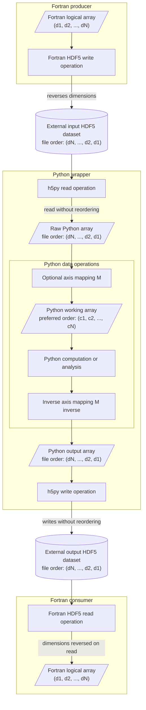

[Regression tests](../README.md) / [Learning guides](README.md) / HDF5 array ordering

**Navigation:** [Previous: Architecture](regression_test_architecture.md) | [Up: Learning guides](README.md) | [Next: Build system](build_system.md)

---

# HDF5 array ordering across Fortran and Python

The core HDF5 library uses the C array convention, in which the last index
varies fastest. Fortran uses column-major arrays, in which the first index
varies fastest. The HDF5 Fortran interface reconciles these conventions by
reversing the dimension order when a Fortran program writes an array.

The Fortran interface applies the reverse conversion when another Fortran
program reads the dataset. A Fortran-to-Fortran exchange therefore preserves
the expected logical array order:

```text
Fortran array:  A(d1, d2, ..., dN)
HDF5 file:      A(dN, ..., d2, d1)
Fortran array:  A(d1, d2, ..., dN)
```

HDFView and h5py instead expose the dimension order recorded in the HDF5 file.
They do not apply the Fortran conversion. Consequently,

```text
Fortran: A(i, j, k)
HDFView: A(k, j, i)
h5py:    raw[k, j, i]
```

## Concrete example

The FIDASIM charge-exchange table's Fortran writer defines

```fortran
dim3 = [n_max, m_max, nenergy]
```

and writes `cx(initial level, final level, relative energy)`. For
`n_max = 12`, `m_max = 12`, and `nenergy = 200`, HDFView reports the dataset
shape `(200, 12, 12)`, and h5py exposes

```text
cx[relative energy, final level, initial level]
```

The values are not corrupted; only their indexing convention changes. Because
the two level axes both have length 12, their physical meanings must come from
the Fortran writer rather than from the dataset shape alone.

## The Fortran-Python-Fortran round-trip rule

When Python sits between a Fortran producer and a Fortran consumer, the array
passed to the h5py writer must use the HDF5 file order that the Fortran reader
will convert into the consumer's required logical order:

- If Python keeps the raw h5py axis order, it should write that array back
  without reordering it.
- If Python reorders the raw array into a preferred working order, it must
  apply the inverse mapping before calling the h5py writer.

In the diagram, `M` maps the h5py file order into the preferred Python working
order `(c1, c2, ..., cN)`. `M inverse` restores the file order. Both are
identity operations when Python works directly in h5py order.



## Implementation checklist

For every exchanged dataset:

- Document the Fortran logical order, h5py file order, and Python working
  order.
- Validate the raw rank and dimensions.
- Keep `M` and `M inverse` at the Python input and output boundaries.
- Use explicit operations such as `transpose` or `swapaxes`, with comments
  naming the semantic axes.
- Leave Python-only outputs in the preferred Python order when no Fortran HDF5
  reader consumes them.

---

**Navigation:** [Previous: Architecture](regression_test_architecture.md) | [Up: Learning guides](README.md) | [Next: Build system](build_system.md)
