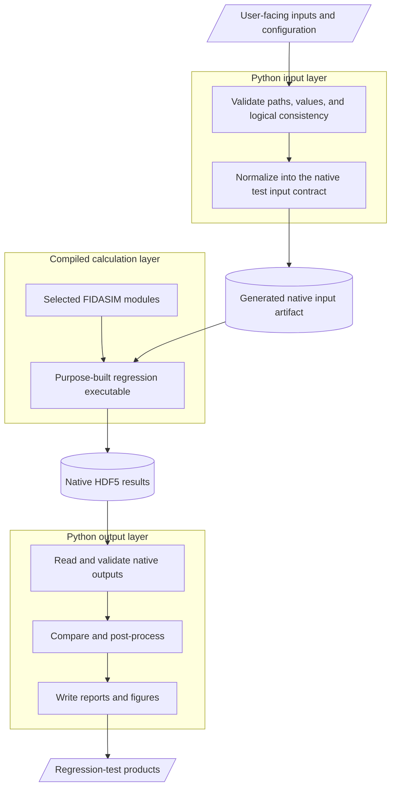

[Regression tests](../README.md) / [Learning guides](README.md) / Architecture

**Navigation:** [Previous: Learning guides](README.md) | [Up: Learning guides](README.md) | [Next: HDF5 array ordering](hdf5_array_ordering.md)

---

# Regression-test architecture

FIDASIM regression workflows separate user-facing orchestration from compiled
numerical calculations. This separation keeps configuration validation and
post-processing readable while allowing the calculation under test to use the
same compiled FIDASIM implementation as production code.

## Layered workflow

This is a common architecture, not a requirement that every test implement
every box. For example, a deterministic self-checking test may embed its
fixtures and expected values directly in the compiled executable and write a
text report without Python post-processing.

## Python input layer

The input layer may validate public configuration, resolve paths, check
logical consistency, and generate a native input artifact for the compiled
calculation. Users normally edit the documented public configuration rather
than the generated native artifact. The generated form remains inspectable
when debugging or reproducing a run.

## Compiled calculation layer

The compiled program is not necessarily the main FIDASIM executable. Many
regression tests build a small, purpose-specific Fortran executable and link it
against selected FIDASIM modules. This isolates the numerical procedure under
test while retaining the production implementation.

Each test portal must state which procedures it exercises and which setup or
support operations belong only to the harness.

## Python output layer

The output layer reads the calculation's native outputs and may validate
schemas, compute comparisons, generate figures, and write a persistent report.
Keeping those responsibilities outside the compiled numerical kernel makes
the workflow easier to inspect and debug.

## Data-boundary rules

- Document public configuration separately from generated native inputs.
- Validate generated inputs before invoking the compiled calculation.
- Preserve native outputs as evidence when a comparison fails.
- Document the semantic meaning, units, shape, and ordering of exchanged data.
- Return a nonzero status after useful reports and figures have been written.

For multidimensional HDF5 datasets, continue with the
[HDF5 array-ordering guide](hdf5_array_ordering.md).

---

**Navigation:** [Previous: Learning guides](README.md) | [Up: Learning guides](README.md) | [Next: HDF5 array ordering](hdf5_array_ordering.md)
